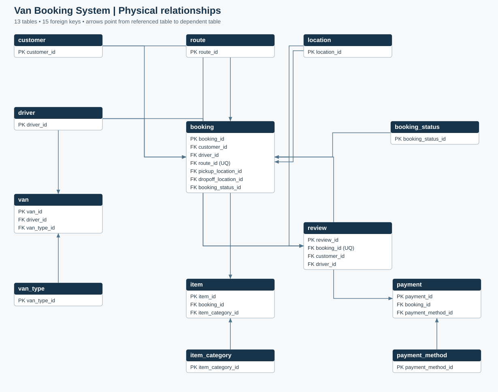

# Van Booking System

**Relational database design · SQL implementation · Business reporting**

Academic database prototype for a proposed platform connecting customers who need furniture or item transportation with van drivers. The project explores how structured data can support bookings, transparent pricing, resource planning and business decisions. It is a database layer, not a deployed app or a live booking service.

## Project background and contribution

Developed as a two-person Databases coursework project during BSc Computing & Digital Technologies studies at the University of Roehampton (2026). My contribution included developing the business concept, identifying requirements and attributes, reviewing the ERD and relationships, and helping translate the data model into SQL. This portfolio revision adds synthetic demonstration data, a schema-derived diagram, reporting queries and validation checks, prepared with AI assistance. The original coursework was collaborative; the portfolio does not claim sole authorship.

## Database at a glance

| Metric | Value |
|---|---:|
| Relational tables | 13 |
| Primary keys | 13 |
| Foreign-key constraints | 15 |
| Synthetic records | 62 |
| Business reporting queries | 7 |

Technology: MySQL/MariaDB, SQL, phpMyAdmin and XAMPP. The original export targeted MariaDB 10.4.32.

## Architecture



The diagram is reconstructed from the implemented schema; arrows point from referenced parent tables to child tables. It is not the original coursework graphic.

- **People and fleet:** customer, driver, van, van_type
- **Bookings and routes:** booking, booking_status, route, location
- **Items and payments:** item, item_category, payment, payment_method
- **Feedback:** review

Primary and foreign keys preserve referential integrity. Unique keys limit a booking to one review and constrain reuse of a route. Reviews in the sample data belong to completed bookings. Authentication is outside scope: password values are deliberately unusable placeholders, not hashes.

## Business reporting

Run [business_queries.sql](business_queries.sql) to explore booking status, completed booking charges, recorded payments, driver performance, pickup demand, fleet composition and quote accuracy.

Example results from the synthetic dataset (GBP):

| Indicator | Demonstration result |
|---|---:|
| Completed bookings | 2 |
| Completed booking charges | £170.00 |
| Average completed booking charge | £85.00 |
| Recorded receipts including deposits | £225.00 |

Charges are not cash receipts or profit. Receipts can include advance payments for incomplete bookings. The data model does not associate a specific van with each booking, so fleet counts are available but actual vehicle utilisation is not.

## Getting started

1. Start MySQL or MariaDB locally (for example, using XAMPP).
2. Create an empty database named van_booking_system in phpMyAdmin and select it.
3. Import [van_booking_system.sql](van_booking_system.sql) into that database (fresh database only).
4. Run [business_queries.sql](business_queries.sql) for reporting and [validation.sql](validation.sql) for consistency checks.

Alternatively, using the MySQL client from this directory:

```sh
mysql -u root -p -e 'CREATE DATABASE van_booking_system;'
mysql -u root -p van_booking_system < van_booking_system.sql
mysql -u root -p van_booking_system < business_queries.sql
mysql -u root -p van_booking_system < validation.sql
```

## Validation and limitations

The revised schema, keys and seed records were converted to a SQLite-compatible test model for local checks in the portfolio preparation: 15 foreign-key relationships passed integrity checks, seven reporting queries ran, and three validation checks returned zero exceptions. The original MySQL/MariaDB dump has **not** been executed against a live MySQL/MariaDB server in this review. Vendor-specific import behaviour and production readiness remain unverified.

The portfolio contains fictional people, reserved example-domain emails, demonstration telephone numbers and explicitly fictional addresses, licence and registration identifiers. No real users, transactions or credentials are represented.

Future work: assign vehicles to bookings, enforce completed-booking review rules in the application or database, implement secure authentication, develop a customer interface, and expand reporting to actual utilisation and profitability.
